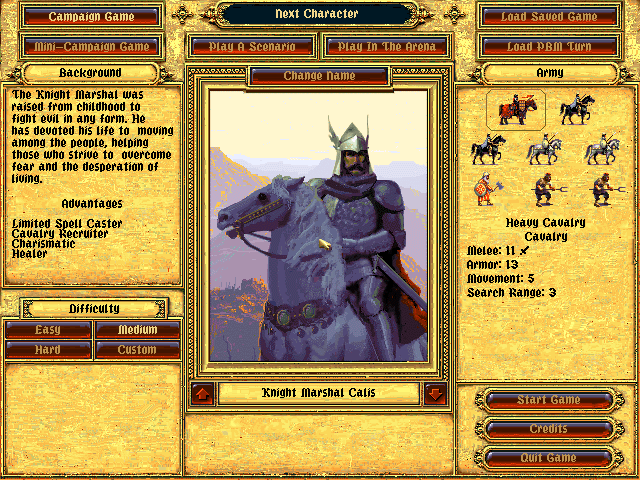
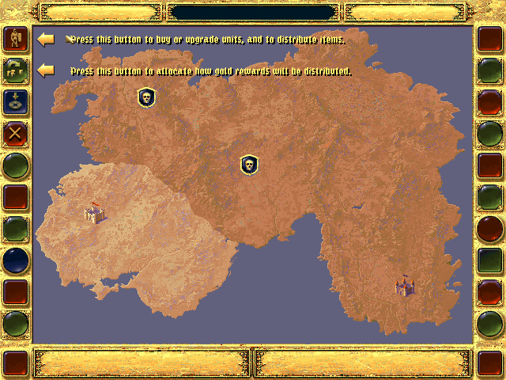
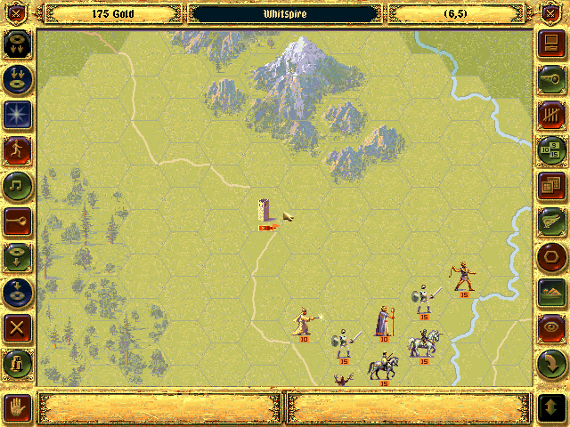

# Fantasy General runner

Run SSI's *Fantasy General* (1996, DOS) on Linux and Windows from the
original GOG game files, without DOSBox.

`fg-runner` loads the game's own `BARENA.EXE` and runs its code unchanged,
replacing DOS/4GW, DOS, the BIOS and the PC hardware (VGA/VESA, mouse,
timer, Sound Blaster, CD drive) with SDL3. The game's code runs in the
Unicorn CPU emulator (default; any 64-bit host) or natively (32-bit Linux).
A few hooks smooth over speed that came from 1996 hardware (scrolling, the
computer's moves) and add conveniences (eight-way and arrow-key scrolling).
The goal is a ready-to-run executable for each platform that works with
the player's installed game.

<p>
  
  
  
</p>

**No game files are in this repository.** Everything is read from a legally
owned install (the GOG version). Anything derived from the game
(`extracted/`, `ghidra-project/`) is git-ignored; the only exception is the
three screenshots in `docs/screenshots/` (taken with the runner).

## Getting the game

The runner needs the game **installed** somewhere: it reads the files the
GOG installer puts on disk; it does not unpack the installer itself.

1. Buy *Fantasy General* on GOG.com and download either offline installer:
   `fantasy_general_*.sh` (Linux) or `setup_fantasy_general_*.exe` (Windows).
   The game files in both are the same, so either works on either system.
2. Install it:
   - Linux: `sh fantasy_general_*.sh` (default `~/GOG Games/Fantasy General`).
   - Windows: run the setup (default `C:\GOG Games\Fantasy General`), or
     install through GOG Galaxy.
   - Heroic or Lutris installs work too.
3. Start the runner. It finds the game by itself in those places (on
   Windows also through the registry entry GOG writes). If it is somewhere
   else, it asks for the folder once and remembers the choice
   (`~/.local/share/fg-runner/game-dir.txt`, `%APPDATA%\fg-runner\game-dir.txt`).
   Either the install folder or the folder holding `EXE\BARENA.EXE` will do.

Saved games (and anything else the game writes) go where GOG's own DOSBox
setup puts them, so saves are shared with it:
- Windows/Galaxy install: `<install>\cloud_saves` (Galaxy syncs it).
- Linux install: the game's own `SAVES` folder.
- An install the runner cannot write to (e.g. `C:\Program Files`): the
  per-user folder (`~/.local/share/fg-runner/drive-c`,
  `%APPDATA%\fg-runner\drive-c`).

With `cloud_saves` or `drive-c`, the install itself is never written to:
the game sees its own files with that folder laid over them, the same as
GOG's DOSBox overlay mount. `--save-dir DIR` chooses the folder yourself.

`--game-dir DIR` or `FG_GAME_DIR=DIR` skip the search. Without a desktop
(`--headless`) the runner cannot ask and stops with a message instead.

Not wanting to run GOG's installer: the files can also be unpacked by hand,
`unzip fantasy_general_*.sh 'data/noarch/game/data/*'` (the game is then in
`data/noarch/game/data`) or `innoextract -d fg setup_fantasy_general_*.exe`
(in `fg`); then choose that folder when the runner asks.

## Running the game natively

```sh
tools/run.sh                 # builds the runner, extracts the CD data track, starts the game
FG_CPU=native tools/run.sh   # the same with the native CPU backend (32-bit Linux build)
```

The game starts fullscreen (`--window` starts it in a window instead);
Alt+Enter switches between the two. The window is resizable and
aspect-correct. F12 saves
`fg-screenshot.png`. Mouse: captured (kept on the game image) in fullscreen
and after a click into a window; Ctrl+F10 releases or captures it. On the
battle map the arrow keys scroll too (two at once diagonally), like the
pointer at the screen edge.
Useful options (after `tools/run.sh`):

| Option | |
|---|---|
| `--window` | start in a window instead of fullscreen |
| `--scale N` | window size (640×480 × N) |
| `--headless --screenshot F.png --screenshot-after S` | no window; save the screen after S seconds |
| `--events "6 key esc; 15 click 548 400"` | scripted input (keys, clicks) for automated checks |
| `--mute` / `--audio` | no audio / audio even when headless (default: on with a window) |
| `--no-sound` | run without sound effects (hides `DIG.INI`) |
| `--scroll-ms MS` | battle-map edge scrolling: time between steps (default 120; higher is slower) |
| `--original-scrolling` | edge scrolling as in the original: the sides scroll diagonally (default: eight-way, sides straight, corners diagonal) |
| `--ai-move-ms MS` | speed of the computer's unit moves: ms per pixel (default 10, about 0.4 s per hex; 0 = as fast as possible) |
| `--ai-view-ms MS` | on the computer's turn, the least time each map view stays on screen (default 200; 0 = as fast as possible) |
| `--save-dir DIR` | where saves go (default: see "Getting the game") |
| `-- ARGS` | game arguments (default `n`, as GOG's `FG.BAT`) |

`FG_TRACE=1` logs every emulated interrupt and file access; `FG_PROFILE=1`
prints, once a second, where the game spends its time (Ghidra addresses
with likely callers). `--events` also takes `T shot FILE.png` (a
screenshot at T seconds) and `T hold KEY` / `T release KEY` for the arrow
keys (`up`, `down`, `left`, `right`).

Status: intro, menus, campaign start and the strategic map work, with CD
music (the `MUSIC/*.ogg` tracks) and sound effects (Miles mixing natively
into an emulated SB16 driver). Smacker videos, battles and save/load are
not checked yet (the intro Smacker video plays).

## Release packages

Players download a ready-to-run package from the repository's GitHub
Releases. Both packages are built in containers, locally or on GitHub:

```sh
tools/build_release.sh [VERSION]   # needs Podman or Docker; default version from `git describe`
# -> dist/fantasy-general-runner-VERSION-linux-x86_64.tar.gz
#    dist/fantasy-general-runner-VERSION-windows-x64.zip
#    dist/SHA256SUMS-VERSION.txt
```

- **Linux** (`tools/release/linux-build.sh`, Ubuntu 22.04 container):
  `fg-runner` with the C++ runtime and Unicorn linked in, SDL3 bundled in
  `lib/` (found through RPATH `$ORIGIN/lib`), icon,
  `install-desktop-entry.sh` (menu entry) and a player README
  (`runner/linux/README-linux.txt`). Needs only glibc 2.35 or newer; SDL
  loads X11/Wayland/PipeWire/PulseAudio/ALSA from the system at run time.
- **Windows** (`tools/release/windows-build.sh`, Fedora 45 container, which
  calls `tools/build_windows.sh`): MinGW-w64 cross-build, Unicorn static;
  `fg-runner.exe` (GUI program with an icon; from a command prompt it
  prints to that console), `SDL3.dll`, `libwinpthread-1.dll` and a player
  README (`runner/win/README-windows.txt`). `tools/build_windows.sh
  [VERSION]` also works directly on a Fedora host (`mingw64-gcc-c++
  mingw64-SDL3 zip`).

Both write a log to `fg-runner.log` in the per-user folder
(`~/.local/share/fg-runner/`, `%APPDATA%\fg-runner\`) and show errors in a
message box. Dependencies are pinned and checksummed (SDL 3.4.20 for Linux,
Unicorn 2.1.4); `tools/make_icon.py` draws the icon.

**GitHub Actions** (`.github/workflows/release.yml`) runs the same script:
pull requests and manual runs attach the packages to the run as an
artifact; pushing a tag `vX.Y.Z` publishes a GitHub Release with both
packages and the checksums (notes: `tools/release/release-notes.md`).

```sh
git tag v0.5.0 && git push origin v0.5.0    # build and publish release 0.5.0
```

Distributing the packages means offering the source (GPL).

## Setup

```sh
tools/setup_tooling.sh      # Java 25, Ghidra 12.2 (+ Watcom cspec, GhidraMCP), Open Watcom v2 -> tools/vendor/
tools/ghidra/import.sh      # extract BARENA.EXE and build ghidra-project/FantasyGeneral.gpr
tools/ghidra.sh             # open Ghidra
```

Runner build requirements (Fedora), default Unicorn backend: `gcc-c++ cmake
ninja-build SDL3-devel unicorn-devel`.

Native backend (`FG_CPU=native`): `gcc-c++`, `cmake`, `ninja-build`,
`glibc-devel.i686`, `libstdc++-devel.i686`, `libatomic.i686`, `SDL3-devel.i686`.
Runtime (32-bit client libraries): `pipewire-libs.i686` for sound;
`mesa-dri-drivers.i686 mesa-libEGL.i686 mesa-libGL.i686` for a hardware-accelerated
Wayland window (without them the runner falls back to X11 software rendering).

## Layout

| Path | What |
|---|---|
| `tools/le_extract.py` | Parses the DOS/4GW-bound LE executable; writes object images, fixups and an ELF for Ghidra |
| `tools/setup_tooling.sh` | Installs the pinned, checksum-verified toolchain into `tools/vendor/` |
| `tools/ghidra/x86watcom.cspec` | Ghidra compiler spec for Watcom's register calling convention |
| `tools/ghidra/import.sh` | Creates the Ghidra project from the game executable |
| `tools/ghidra/scripts/` | Ghidra scripts (post-import code recovery, reports, decompile dump) |
| `runner/` | The runner (C++20, SDL3; Unicorn or native 32-bit CPU backend) |
| `tools/run.sh`, `tools/extract_cd.py` | Build + run; extract the CD data track for drive D: |
| `tools/build_windows.sh`, `runner/win/` | Windows cross-build and package; manifest, player README |
| `tools/ghidra/run.py` | Run a repo Ghidra script inside the running Ghidra (via GhidraMCP) |
| `docs/NOTES.md` | Findings about the executable and game |
| `docs/RUNNER.md` | What the runner emulates and how, and why it is 32-bit |
| `docs/STATUS.md` | Current state, how to resume, non-obvious lessons |
| `.mcp.json` | GhidraMCP bridge for Claude Code (needs Ghidra running with the plugin enabled) |

## Licence

GPL-2.0-or-later (see `LICENSE`), except `runner/third_party/` (own
licences). The Unicorn backend links Unicorn (GPL-2.0), so its builds are
distributed under GPL-2.0. No game files or game code are included.
